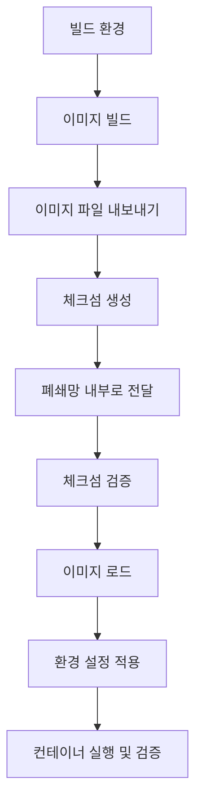
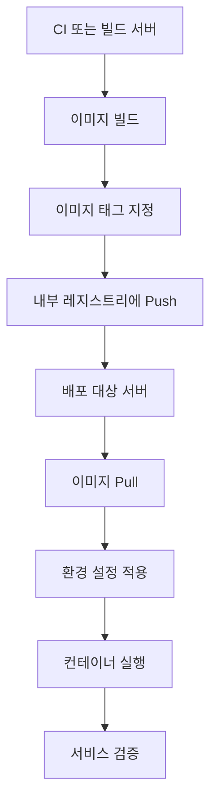

### Intro

프론트엔드 애플리케이션을 개발할 때는 로컬 환경에서 정상적으로 실행되는지, 빌드 결과물이 올바르게 생성되는지에 집중하는 경우가 많다.

하지만 애플리케이션을 고객사 내부 환경에 배포해야 한다면 고려해야 할 조건이 달라진다.

외부 네트워크에 접근할 수 없는 환경일 수도 있고, 고객사 내부에 별도의 컨테이너 레지스트리가 운영되고 있을 수도 있다. 고객별 요구사항에 따라 서로 다른 이미지가 필요할 수도 있다.

이러한 환경에서는 단순히 애플리케이션을 컨테이너로 실행하는 것만으로는 충분하지 않다. 이미지를 어떻게 준비하고 전달할 것인지, 실행 환경에 따라 달라지는 설정을 어디에서 관리할 것인지, 배포 이후 정상적으로 동작하는지 어떻게 확인할 것인지까지 함께 설계해야 한다.

이번 글에서는 프론트엔드 애플리케이션을 컨테이너로 배포한다는 관점에서, 온프레미스 환경에서 마주할 수 있는 세 가지 상황과 각각의 설계 방법을 정리해 보려고 한다.

- 완전 폐쇄망 환경에서 이미지 전달하기
- 내부 컨테이너 레지스트리를 통한 이미지 배포
- 고객별 이미지 빌드와 런타임 설정 분리

세 가지는 서로 배타적인 유형이 아니다. 예를 들어 완전 폐쇄망 안에 내부 레지스트리가 존재하고, 그 레지스트리에 고객별 이미지를 저장하는 구조도 가능하다.

따라서 각각을 독립적인 배포 방식이라기보다, 배포 환경을 구성하는 서로 다른 조건으로 이해하는 것이 좋다.

### 1. 프론트엔드 컨테이너 이미지 설계

먼저 배포 환경에 관계없이 공통으로 적용할 수 있는 부분부터 살펴보자.

프론트엔드 애플리케이션을 컨테이너화할 때는 빌드 환경과 실제 실행 환경을 구분할 필요가 있다.

예를 들어 정적 SPA(Single Page Application)는 Node.js 환경에서 빌드한 결과물을 웹 서버를 통해 제공할 수 있다. 이 경우 실제 실행 환경에는 애플리케이션 빌드에 사용했던 모든 도구가 필요하지 않다.

이러한 구조를 구현하는 방법 중 하나가 멀티 스테이지 빌드(Multi-stage build)다.

#### 1.1. 멀티 스테이지 빌드

다음은 Node.js 기반 프론트엔드 애플리케이션을 빌드한 뒤, Nginx를 통해 정적 파일을 제공하는 예시다.

```dockerfile
# Build stage
FROM node:22-alpine AS builder

WORKDIR /app

COPY package.json pnpm-lock.yaml ./
RUN corepack enable && pnpm install --frozen-lockfile

COPY . .
RUN pnpm build

# Runtime stage
FROM nginx:alpine AS runtime

COPY --from=builder /app/dist /usr/share/nginx/html

EXPOSE 80
```

이 예시는 빌드 결과물이 `dist` 디렉터리에 생성되고, Nginx가 해당 파일을 정적으로 제공하는 SPA를 전제로 한다.

SSR(Server-Side Rendering) 애플리케이션이나 Node.js 서버가 직접 실행되어야 하는 구조라면 런타임에 필요한 서버 코드와 의존성 등을 별도로 포함해야 하므로 동일한 Dockerfile을 그대로 사용할 수는 없다.

멀티 스테이지 빌드의 핵심은 단순히 Dockerfile을 여러 단계로 나누는 것이 아니다. 빌드에 필요한 도구와 실제 실행에 필요한 구성 요소를 분리하여 최종 이미지에 불필요한 빌드 환경이 포함되지 않도록 하는 데 있다.

물론 이 예시만으로 이미지가 안전하거나 최적화되었다고 단정할 수는 없다. 실제 이미지 크기, 취약점, 권한 설정, 런타임 동작 등을 별도로 확인해야 한다.

#### 1.2. `.dockerignore`와 빌드 컨텍스트

Docker 이미지를 빌드할 때는 Dockerfile뿐 아니라 빌드 컨텍스트(Build context)도 함께 고려해야 한다.

빌드 컨텍스트는 빌드 과정에서 Docker 엔진에 전달되는 파일 집합이다. 프로젝트 루트에서 `docker build`를 실행하면 해당 디렉터리가 빌드 컨텍스트가 되는 경우가 일반적이다.

이때 `.dockerignore`를 이용하면 빌드에 필요하지 않은 파일을 컨텍스트에서 제외할 수 있다.

```dockerignore
node_modules
dist
.git
.env
.env.*
coverage
*.log
```

위 설정은 예시이므로 실제 프로젝트의 빌드 구조에 맞춰 조정해야 한다. 특히 빌드에 필요한 환경별 설정 파일이나 인증서 등을 무조건 제외하는 방식은 적절하지 않을 수 있다.

여기서 구분해야 할 것이 세 가지 있다.

| 구분            | 주요 목적                                           |
| --------------- | --------------------------------------------------- |
| 빌드 컨텍스트   | 빌드에 전달되는 입력 파일 관리                      |
| 최종 이미지     | 실제 실행에 필요한 파일과 런타임 구성 관리          |
| 프론트엔드 번들 | 브라우저에 전달되는 JavaScript, CSS, 정적 자원 관리 |

`.dockerignore`는 빌드 컨텍스트를 줄이는 데 사용한다. 최종 이미지 크기는 주로 Dockerfile의 단계 구성과 복사 대상, 런타임 의존성 등에 영향을 받으며, 브라우저 번들 크기는 코드 분할이나 의존성 분석 등 별도의 최적화가 필요하다.

따라서 `.dockerignore`를 추가했다는 사실만으로 최종 이미지나 브라우저 번들이 작아졌다고 판단해서는 안 된다.

### 2. 완전 폐쇄망 환경에서 이미지 전달하기

완전 폐쇄망 환경에서는 외부 네트워크에 접근할 수 없다는 제약을 먼저 고려해야 한다.

개발 환경에서는 외부 레지스트리에서 이미지를 내려받고, 패키지 저장소에서 의존성을 설치하는 작업이 자연스럽다. 하지만 대상 환경에서 외부 네트워크에 접근할 수 없다면 이러한 작업을 배포 시점에 그대로 수행할 수 없다.

따라서 배포에 필요한 이미지와 의존성을 사전에 준비하고, 폐쇄망 내부에서 사용할 수 있도록 전달하는 과정이 필요하다.

#### 2.1. 이미지 전달 흐름



이 과정에서 이미지 파일을 전달하는 것과 애플리케이션 실행에 필요한 모든 의존성을 확보하는 것은 다른 문제다.

예를 들어 프론트엔드 이미지가 정상적으로 전달되더라도, 해당 애플리케이션이 호출하는 API 서버나 인증 서버에 접근할 수 없다면 주요 기능은 정상적으로 동작하지 않을 수 있다.

또한 Dockerfile에서 사용하는 베이스 이미지와 빌드 의존성도 사전에 확보해야 한다. 폐쇄망 내부에서 빌드까지 수행해야 한다면 필요한 패키지와 의존성을 내부에서 이용할 수 있도록 별도로 준비해야 한다.

#### 2.2. 이미지 내보내기와 가져오기

Docker 이미지를 파일로 전달하는 방법 중 하나는 `docker save`와 `docker load`를 사용하는 것이다.

먼저 빌드 환경에서 이미지를 생성한다.

```bash
docker buildx build \
  --platform linux/amd64 \
  --load \
  -t frontend:1.0.0 \
  -f Dockerfile .
```

위 명령어는 대상 서버가 `linux/amd64`를 사용하는 경우를 가정한다. `--load`는 빌드 결과를 로컬 Docker 이미지 저장소에 적재하기 위한 옵션이다.

이후 이미지를 파일로 내보내고 체크섬을 생성한다.

```bash
docker save frontend:1.0.0 -o frontend.tar

sha256sum frontend.tar > frontend.tar.sha256
```

생성된 이미지 파일과 체크섬 파일을 폐쇄망 내부로 전달한 뒤 다음과 같이 검증할 수 있다.

```bash
sha256sum -c frontend.tar.sha256

docker load -i frontend.tar

docker image inspect frontend:1.0.0
```

체크섬 검증은 전달 과정에서 파일이 변경되거나 손상되었는지 확인하는 데 도움이 된다. 다만 체크섬이 일치한다는 사실만으로 이미지의 출처나 신뢰성까지 보장되는 것은 아니다. 신뢰할 수 있는 경로로 전달된 체크섬인지도 함께 고려해야 한다.

#### 2.3. 실행 환경 검증

이미지를 정상적으로 불러왔다면 다음 단계는 실제 실행 환경에서의 검증이다.

```bash
docker run -d \
  --name frontend \
  -p 3000:80 \
  frontend:1.0.0
```

이 명령어는 앞서 작성한 Nginx 기반 SPA 이미지의 실행 예시다.

컨테이너가 실행 중인지 확인하는 것만으로는 충분하지 않다.

```bash
docker ps
docker logs frontend
```

이후 실제 서비스 URL에 접근해 정적 파일이 제공되는지 확인하고, API 호출이나 인증 등 주요 사용자 흐름도 검증해야 한다.

폐쇄망에서는 특히 DNS, 내부 인증서, 프록시 설정, 백엔드 접근 정책 등 외부 인터넷 연결과는 별개인 내부 네트워크 조건을 확인할 필요가 있다.

**설계 관점에서 중요한 점은 폐쇄망 배포를 이미지 복사 작업으로만 보지 않는 것이다.** 이미지와 실행 의존성을 사전에 준비하고, 대상 환경에서 실행 가능한 상태인지 검증하는 과정까지 배포 범위에 포함해야 한다.

### 3. 내부 컨테이너 레지스트리를 이용하는 환경

폐쇄망이라고 해서 반드시 이미지 파일을 직접 전달해야 하는 것은 아니다.

고객사 내부에 컨테이너 레지스트리가 운영되고 있다면, 내부 네트워크를 통해 이미지를 저장하고 배포할 수 있다.

이 경우 이미지 전달 절차는 단순해질 수 있지만, 이미지 버전 관리와 접근 권한, 배포 대상의 식별이 중요해진다.

#### 3.1. 내부 레지스트리를 통한 배포 흐름



내부 레지스트리는 단순히 이미지를 보관하는 저장소가 아니라, 배포 대상이 어떤 이미지를 사용해야 하는지 관리하는 기반이 될 수 있다.

다만 레지스트리가 존재한다고 해서 배포의 재현성이나 롤백이 자동으로 보장되는 것은 아니다. 이를 위해서는 버전 지정과 배포 이력 관리가 별도로 필요하다.

#### 3.2. 이미지 태그 지정과 배포

다음은 내부 레지스트리를 이용하는 기본적인 예시다.

```bash
# 이미지 빌드
docker build \
  -f Dockerfile \
  -t registry.internal.example/frontend:1.0.0 .

# 레지스트리에 이미지 등록
docker push registry.internal.example/frontend:1.0.0

# 배포 대상 서버에서 이미지 가져오기
docker pull registry.internal.example/frontend:1.0.0
```

`registry.internal.example`은 설명을 위한 예시 주소다.

이때 `1.0.0`처럼 명시적인 버전을 사용하면 어떤 버전을 배포했는지 파악하기 쉽다. 반면 `latest`처럼 변경 가능한 태그에만 의존하면 배포 당시 실제로 어떤 이미지가 사용되었는지 추적하기 어려워질 수 있다.

태그는 이미지에 붙이는 이름이므로, 태그가 항상 동일한 이미지를 가리킨다고 가정해서는 안 된다.

보다 엄격하게 배포 대상을 고정하려면 레지스트리에서 확인한 이미지 다이제스트를 사용할 수 있다.

```bash
docker pull \
  registry.internal.example/frontend@sha256:<digest>
```

`<digest>`에는 실제 레지스트리에서 확인한 값을 사용해야 한다.

다이제스트를 통해 이미지 콘텐츠를 식별하면 태그가 다른 이미지를 가리키도록 변경되더라도 배포 대상을 명확하게 지정할 수 있다.

#### 3.3. 배포 이후의 운영 문제

이미지를 내부 레지스트리에서 가져올 수 있다고 해서 운영 측면의 검증이 끝난 것은 아니다.

실제 환경에서는 다음과 같은 항목을 확인해야 한다.

- 레지스트리 접근 권한과 인증 정보가 적절하게 관리되는가?
- 배포 대상 이미지의 버전을 확인할 수 있는가?
- 이미지 취약점 검사와 업데이트 정책이 마련되어 있는가?
- 배포 실패 시 이전 버전으로 복구할 수 있는가?
- 이미지와 함께 적용된 환경 설정도 추적할 수 있는가?

특히 롤백은 이전 이미지가 레지스트리에 남아 있다는 사실만으로 완성되지 않는다. 이전 버전의 설정과 호환되는지, 데이터나 API 계약이 변경되지는 않았는지까지 고려해야 한다.

**내부 레지스트리를 사용하는 환경에서 중요한 것은 이미지의 전달 경로보다 배포 대상을 어떻게 식별하고 관리하는가에 있다.**

### 4. 고객별 이미지가 필요한 환경

세 번째 상황은 고객마다 서로 다른 설정이나 기능을 요구하는 경우다.

예를 들어 고객별로 제공 기능이 다르거나, 프론트엔드 빌드 결과물에 포함되는 공개 설정이 다를 수 있다. 이러한 차이를 어떻게 처리하느냐에 따라 이미지 관리 방식이 달라진다.

여기서 먼저 구분해야 할 것은 고객별 이미지 빌드와 고객별 런타임 설정이다.

두 방식은 비슷해 보이지만, 설정이 반영되는 시점과 배포 산출물의 관리 방식이 다르다.

#### 4.1. 공통 이미지와 고객별 런타임 설정

애플리케이션의 차이가 실행 시점에 전달할 수 있는 설정에 한정된다면, 공통 이미지를 만들고 고객별 설정을 별도로 주입하는 방식을 고려할 수 있다.

```yaml
# compose.yaml
services:
  frontend:
    image: registry.internal.example/frontend:1.0.0
    environment:
      API_UPSTREAM_URL: ${API_UPSTREAM_URL:?API_UPSTREAM_URL is required}
    ports:
      - "3000:3000"
```

위 설정은 설명을 위한 예시이며, 애플리케이션이 실제로 `API_UPSTREAM_URL` 환경 변수를 런타임에 읽는 구조여야 한다.

이 방식을 사용하면 동일한 이미지에 서로 다른 설정을 적용할 수 있다.

```bash
# 고객 A 환경
API_UPSTREAM_URL=https://api-a.internal.example

# 고객 B 환경
API_UPSTREAM_URL=https://api-b.internal.example
```

실제 운영에서는 고객별 환경 설정을 별도 파일이나 배포 시스템에서 관리할 수 있다.

이때 설정 파일과 이미지 버전을 함께 추적하면 어떤 이미지가 어떤 설정으로 실행되었는지 확인하기 쉬워진다.

단, 환경 변수로 값을 전달할 수 있다는 사실과 애플리케이션이 해당 값을 실제로 반영한다는 것은 별개의 문제다. 정적 프론트엔드의 경우 브라우저에 전달된 번들에 이미 포함된 값은 컨테이너 환경 변수만 변경한다고 자동으로 바뀌지 않는다.

서버 런타임에서 설정을 읽어 HTML이나 별도 설정 파일로 전달하는 구조 등을 마련해야 실행 시점의 변경이 가능하다.

#### 4.2. 고객별 빌드 설정이 필요한 경우

반대로 고객별 기능 차이가 빌드 결과물에 반영되어야 한다면 고객별 빌드를 고려할 수 있다.

예를 들어 빌드 시점에 공개 API 주소를 정적으로 치환하는 프론트엔드 프로젝트는 다음과 같은 형태로 빌드할 수 있다.

```dockerfile
FROM node:22-alpine AS builder

WORKDIR /app

COPY package.json pnpm-lock.yaml ./
RUN corepack enable && pnpm install --frozen-lockfile

COPY . .

ARG VITE_PUBLIC_API_URL
ENV VITE_PUBLIC_API_URL=${VITE_PUBLIC_API_URL}

RUN pnpm build

FROM nginx:alpine AS runtime

COPY --from=builder /app/dist /usr/share/nginx/html
```

빌드 명령어는 다음과 같다.

```bash
docker build \
  --build-arg VITE_PUBLIC_API_URL=https://api-a.example.com \
  -t frontend:customer-a .
```

이 예시는 빌드 도구가 `VITE_PUBLIC_API_URL`을 빌드 시점에 읽어 결과물에 반영하는 구성을 전제로 한다.

또한 `VITE_`와 같은 클라이언트 노출용 환경 변수에는 비밀 정보나 인증 토큰을 넣어서는 안 된다. 빌드 인자 역시 비밀 정보를 안전하게 보관하기 위한 수단으로 사용해서는 안 된다.

고객별 빌드를 선택하면 각 고객의 구성을 이미지에 명확하게 고정할 수 있다. 하지만 고객 수가 늘어날수록 이미지 버전과 빌드 설정, 검증 결과를 관리하는 부담도 함께 증가한다.

따라서 고객별 빌드가 필요하다는 이유만으로 모든 설정을 이미지에 포함하는 것은 적절하지 않다.

### 4.3. 두 방식 중 무엇을 선택할 것인가?

| 판단 기준          | 공통 이미지 + 런타임 설정    | 고객별 이미지 빌드           |
| ------------------ | ---------------------------- | ---------------------------- |
| 설정 반영 시점     | 실행 시점                    | 빌드 시점                    |
| 이미지 재사용성    | 높음                         | 상대적으로 낮음              |
| 고객별 산출물 관리 | 비교적 단순                  | 고객별 버전 관리 필요        |
| 빌드 결과물의 차이 | 공통 결과물 유지             | 고객별로 달라질 수 있음      |
| 주요 고려 사항     | 설정 검증과 런타임 반영 구조 | 빌드 추적성과 이미지 수 증가 |

이 표는 절대적인 우열을 나타내는 것은 아니다.

고객별로 실제 기능이나 정적 산출물이 달라진다면 별도 빌드가 적절할 수 있다. 반면 API 주소나 실행 환경의 연결 정보처럼 런타임에 변경할 수 있는 값이라면 공통 이미지를 재사용하는 편이 효율적일 수 있다.

결국 중요한 것은 **어떤 차이를 이미지에 고정하고, 어떤 차이를 실행 환경에서 관리할 것인지 명확하게 구분하는 것**이다.

### 5. 배포 방식과 관계없이 확인해야 할 것들

앞에서 살펴본 세 가지 상황은 이미지의 전달 방식이나 설정 관리 방식에서 차이가 있다. 하지만 실제 서비스 배포라는 관점에서 공통으로 확인해야 할 항목도 존재한다.

| 검증 항목     | 확인 목적                                                        |
| ------------- | ---------------------------------------------------------------- |
| 이미지 무결성 | 전달된 이미지 파일이 변경되거나 손상되지 않았는지 확인           |
| 플랫폼 호환성 | 대상 서버의 아키텍처와 이미지가 호환되는지 확인                  |
| 설정 검증     | 필수 설정 누락이나 잘못된 값이 없는지 확인                       |
| 네트워크 연결 | DNS, TLS, 내부 API 연결 등이 정상적인지 확인                     |
| 버전 추적     | 소스 커밋과 이미지 버전, 다이제스트를 추적할 수 있는지 확인      |
| 실행 검증     | 컨테이너 실행 이후 실제 사용자 흐름이 정상적으로 동작하는지 확인 |
| 복구 가능성   | 이전 버전과 설정을 이용해 복구할 수 있는지 확인                  |

여기서 한 가지 주의할 점이 있다.

컨테이너가 정상적으로 시작되었다는 사실은 서비스의 주요 기능이 정상적으로 동작한다는 의미가 아니다. 마찬가지로 이미지의 체크섬이 일치한다는 사실은 이미지의 신뢰성이나 애플리케이션의 정상 동작을 보장하지 않는다.

각 검증은 서로 다른 문제를 확인한다. 따라서 이미지 전달, 컨테이너 실행, 네트워크 연결, 실제 사용자 흐름을 구분하여 확인하는 것이 좋다.

또한 운영 환경에서 사용할 이미지에는 불필요한 도구와 파일을 포함하지 않도록 하고, 컨테이너 권한과 비밀 정보 관리 정책을 함께 고려해야 한다.

### 6. 마무리

프론트엔드 애플리케이션을 컨테이너화하는 작업은 Dockerfile을 작성하는 것에서 끝나지 않는다.

특히 온프레미스 환경에서는 네트워크 제약, 이미지 전달 경로, 고객별 설정 관리 방식에 따라 배포 구조가 달라질 수 있다.

완전 폐쇄망에서는 필요한 이미지와 의존성을 사전에 확보하고 전달 이후의 실행 가능성을 검증해야 한다. 내부 레지스트리를 이용하는 환경에서는 이미지의 버전과 다이제스트, 접근 권한을 관리해야 한다. 고객별 이미지가 필요한 환경에서는 빌드 시점 설정과 런타임 설정을 구분하고, 그에 따른 산출물 관리 비용을 고려해야 한다.

이 세 가지 상황에서 공통으로 얻을 수 있는 결론은 다음과 같다.

**컨테이너 배포의 핵심은 애플리케이션을 이미지로 만드는 데 그치지 않고, 대상 환경에서 동일한 결과를 재현하고 검증할 수 있는 구조를 만드는 것이다.**

프론트엔드 엔지니어의 관점에서도 배포는 단순한 인프라 작업만은 아니다. 애플리케이션이 어떤 설정을 필요로 하는지, 어떤 네트워크 경로를 사용하는지, 실행 환경에 따라 어떤 차이가 발생하는지를 이해해야 실제 사용자가 문제없이 기능을 이용할 수 있다.

결국 제품을 안정적으로 전달한다는 것은 개발 환경에서 동작하는 결과물을 만드는 것뿐 아니라, 실제 운영 환경에서도 그 동작을 재현할 수 있도록 설계하는 일이라고 생각한다.

---

#### 참고 및 검증 메모

이 글의 Docker 명령어와 설정은 개념을 설명하기 위한 예시다. 실제 프로젝트에 적용하기 전에는 다음 항목을 확인해야 한다.

- 프로젝트의 빌드 결과물 경로와 실제 런타임 구조
- Docker 및 빌드 도구 버전, 대상 플랫폼
- 런타임 설정을 애플리케이션이 읽고 반영하는 방식
- 내부 레지스트리의 인증 및 접근 정책
- 대상 환경의 네트워크, TLS, DNS 조건

예시 코드는 실제 배포 환경에서 실행 검증한 결과를 의미하지 않는다. 특히 SSR 애플리케이션, 고객별 빌드 구성, 런타임 설정 전달 방식은 프로젝트의 구조에 맞춰 별도로 검증해야 한다.
