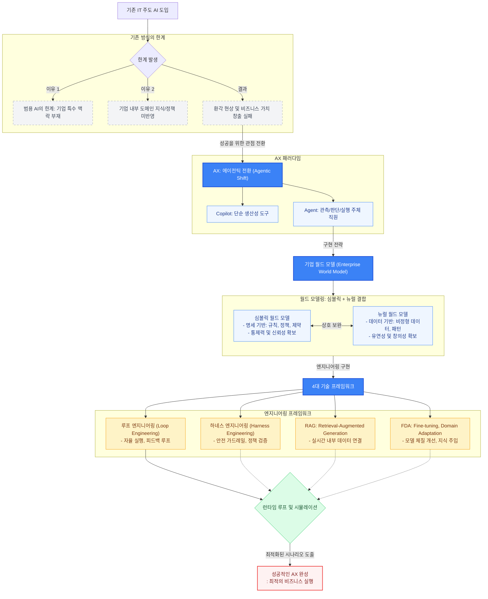

### Intro: 왜 대부분의 기업 AI 도입은 실패하는가?

#### 단순 도구를 넘어 '에이전틱 전환(Agentic Shift)'으로

지금까지의 IT 전환이나 Copilot 방식은 AI를 단순한 생산성 '도구(Tool)'로 다루었다.

하지만 진정한 AX는 AI에 관측, 판단, 실행 권한을 부여하여 하나의 '직원(Agent)'처럼 활용하는 '에이전틱 전환'을 의미한다.

성공적인 AI Transformation(AX)을 위해서 AI를 바라보는 관점 자체를 바꿔야 한다는 의견이 부상중인 시점이다.

#### 기존 IT 주도 접근의 한계

기존 IT 팀 중심의 일방적인 LLM 도입이 실패하는 이유는 AI의 범용성(Generality)이 기업 내부의 특수한 맥락(Context)을 알지 못하기 때문이다.

- **도메인 지식과 정책의 부재**: AI 성능의 승패는 모델 자체보다 기업 내부의 정제된 도메인 지식, 비즈니스 로직, 그리고 업무 정책을 AI가 얼마나 깊이 이해하느냐에 달려 있다.

- **실패 패턴**: 기업 고유의 환경과 이익 구조, 리스크 제약 조건을 학습시키지 않은 범용 AI는 현업에서 쓸 수 없는 '환각'이나 '우회적 결과물'만 내놓게 된다.

### 심볼릭 + 뉴럴 결합과 '월드 모델링(World Modeling)' 이란?

AX 성공의 핵심 열쇠는 기업 환경을 반영한 '월드 모델(World Model)'의 구축, 그리고 '심볼릭(Symbolic)과 뉴럴(Neural)의 결합'이라고, 스윗테크놀로지스 이주환 대표님께서 언사를 진행해주셨다.

(영상 참고 링크 출처 : https://youtu.be/UIQEelaElIQ?si=tlc4qxRJlbrx_fEK)

그럼 과연 '심볼릭 월드 모델'과 '뉴럴 월드 모델'은 무엇이고, 두 월드 모델의 결합은 어떠한 방법으로 이루어지는걸까?

#### 심볼릭 월드 모델 (Symbolic World Model):

심볼릭 월드 모델의 역할은 AI가 한계선을 넘지 않도록 통제하여 신뢰성을 확보함에 있다.
**명세 기반(Specification-based)** 으로 기업의 규정, 프로세스, 재무 제약, 권한 체계 등 절대 준수해야하는 규칙 및 정책을 정의한다.

#### 뉴럴 월드 모델 (Neural World Model):

뉴럴 월드 모델의 역할은 변화하는 환경에 맞춰 최적의 판단을 내리는 창의성과 유연성 제공함에 있다. **데이터 기반(Data-driven)** 으로 시장 변수, 고객 반응, 텍스트/음성 등 비정형 데이터를 유연하게 학습하고 해석한다.

---

기업의 복잡한 의사결정을 AI에게 맡기고자 한다면, **실제 실행 전 최적의 시나리오 도출하는 과정**이 중시될 것이다.

- 심볼릭과 뉴럴이 결합된 환경 내에서 AI Agent는 시뮬레이션을 수행한다.
- 런타임 루프를 돌며 여러가지 가능성을 검증하고, 발생 가능한 리스크를 미리 제어한 후 가장 최상의 비즈니스 이익을 가져다주는 최적의 실행안을 도출한다.

---

### Agentic AX를 구축하는 4대 기술 프레임워크

앞서 명시한 **에이전틱 전환** 및 **월드 모델**을 실제로 구동하기 위한 엔지니어링 차원에서 다음의 4가지 핵심 주축이 요구된다.

#### 1. FDA (Fine-tuning, Domain Adaptation) : 모델의 체질 개선

범용 LLM에 기업 고유의 용어, 도메인 지식, 문맥을 주입하는 작업으로 Continued Pre-training 방식으로 기업 지식을 깊게 주입하고, PEFT(LoRA 등)를 통해 최소한의 자원으로 특정 업무 전용 모델을 연마한다.

#### 2. RAG (Retrieval-Augmented Generation): 실시간 내부 데이터 연결

가중치 변경 없이 최신 내부 규정, 실시간 DB, 보안 문서를 실시간으로 참조하여 심볼릭 월드 모델의 기초 데이터로 활용한다.

#### 3. 하네스 엔지니어링 (Harness Engineering): AI 가드레일 구축

AI Agent가 논점에서 벗어난 행동을 하지 못하도록 통제하는 안전 프레임워크이며, 심볼릭 월드 모델에서 정의한 기업의 정책과 제약 조건을 AI의 입출력 단계에서 강제로 검증하여 보안 유출, 규정 위반, 비즈니스 리스크를 차단한다.

#### 4. 루프 엔지니어링 (Loop Engineering): 자율 실행과 피드백 (Agentic Workflow)

AI가 일회성 답변에 그치지 않고 **[관측 $\rightarrow$ 판단 $\rightarrow$ 실행 $\rightarrow$ 피드백]**을 자율적으로 반복하게 만드는 루프 설계다.시뮬레이션 결과를 바탕으로 스스로 오답을 수정하고, 하위 과업들을 완수해 나가는 **'동적 구성원'**으로서의 AI를 완성한다.

---

---

### Keyword

- AX (AI Transformation, 인공지능 전환): 기업의 단순 업무 디지털화(DX)를 넘어, 의사결정 및 운영 구조 전체를 AI 중심으로 재설계하는 경영 전략적 전환.

- 에이전틱 전환 (Agentic Shift): AI를 단순한 질문-답변 도구(Copilot)가 아닌, 스스로 관측하고 판단하여 업무를 완성하는 독립적인 실행 주체(Agent)로 활용하는 패러다임의 변화.

- 월드 모델 (World Model): AI가 동작하는 대상 세계(기업 내부 환경, 비즈니스 규칙, 시장 변수 등)의 구조와 원리를 이해하고 추론할 수 있도록 가상화한 내부 표현 체계.

- 심볼릭 AI (Symbolic AI): 명시적인 규칙, 논리, 기호(Symbol)를 바탕으로 동작하는 전통적 AI 방식. 가시성과 통제력이 뛰어나 기업의 규정 및 제약 조건 적용에 필수적임.

- 뉴럴 AI (Neural AI): 딥러닝 기반 데이터 학습 모델. 복잡하고 비정형화된 패턴을 유연하게 해석하는 데 강점이 있으나 내부 동작 과정을 설명하기 어려운 한계가 있음.

- FDA (Fine-tuning, Domain Adaptation): 사전 학습된 범용 모델(Pre-trained Model)을 특정 도메인(산업 분야)이나 특정 작업(Task)에 맞춰 가중치를 업데이트하고 최적화하는 기술 영역.

- RAG (Retrieval-Augmented Generation, 검색 증강 생성): LLM이 답변을 생성할 때, 내부 데이터베이스나 외부 지식 베이스에서 관련 최신 정보/문서를 실시간으로 검색하여 참고하도록 만드는 기술.

- 하네스 엔지니어링 (Harness Engineering): AI가 일으킬 수 있는 보안 위험, 규정 위반, 오작동을 방지하기 위해 AI 주변에 안전 구역(가드레일), 입력/출력 검증기, 권한 제어 프레임워크를 설계하는 엔지니어링.

- 루프 엔지니어링 (Loop Engineering): AI가 일회성 답변에 그치지 않고 [관측 -> 판단 -> 실행 -> 평가] 단계를 피드백 루프로 구성하여, 원하는 목표를 달성할 때까지 자율적으로 과업을 반복 완수하도록 시스템을 만드는 기술.

- 런타임 루프 (Runtime Loop): 실제 업무 시스템이 동작하는 시점(Runtime)에 AI Agent가 실시간 데이터와 제약 조건을 반영하여 시뮬레이션을 지속적으로 수행하고 최적의 의사결정을 도출해 내는 실행 프로세스.

### Reference

- https://lilys.ai/digest/10710061/12555133?s=1&noteVersionId=9137326
